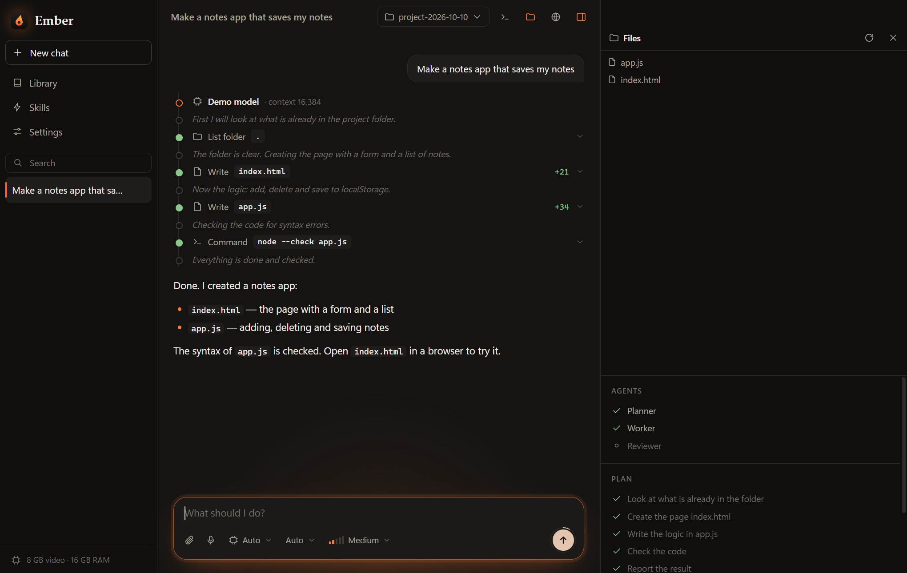
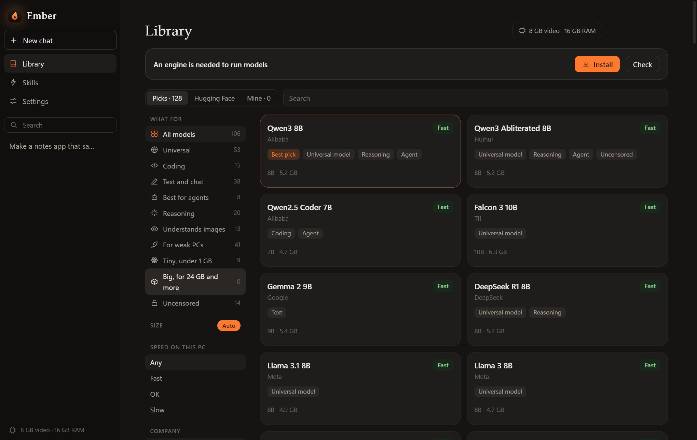

  

  AI that runs on your own computer and does the work for you.

  

## What is Ember?

Ember is an app for Windows. You tell it what you want in plain words, like "make me a website for my photos" or "rename all these files by date", and an AI model does it on your computer. It writes the files, runs them, checks that they work, and shows you every step.

The AI lives on your machine. You don't pay for it, you don't need an account, and what you type stays with you.

## Download

Get `Ember-Setup.exe` from the [Releases](../../releases/latest) page and run it. It installs Ember and puts a shortcut on your desktop.

Windows may show a blue "Windows protected your PC" window the first time. Press "More info", then "Run anyway".

## First steps

1. Ember asks for your language and your name.
2. Open the Library and press Install on the banner at the top. This downloads the engine that runs the models. You do it once.
3. Pick a model. Each one is marked Fast, OK, Slow or Won't run for your computer, and one is marked Best pick. If you're not sure, take that one.
4. Go back to the chat and type what you need.

Models are big files, from 1 to 5 GB for the small ones, so make sure you have the space.

  

## Do I need a powerful computer?

No, but a video card makes a big difference. With 8 GB of video memory the popular models run fast. Without a video card, small models still work, they are slower.

Bigger models are smarter. If a model keeps getting things wrong, try a larger one. Every installed model also has a Test button in the Library that gives it three small tasks and shows how many it got right.

## What you can do with it

- Build things: websites, scripts, bots, small apps. There are ready starting points for the common ones.
- Fix and change files you already have. Every change is shown line by line, and you can undo it.
- Ask about your documents. Drop in a PDF, a Word or Excel file, or a picture.
- Talk instead of typing.
- Let it look things up on the internet. This is optional and you can switch it off.
- See the result right away. Files, a command line and a browser sit in panels next to the chat.

You decide how much Ember may do on its own. It can ask before every change, or work by itself and only stop for things like deleting files or installing programs. Those always need your OK.

## Privacy

The model runs on your computer, and your chats are stored on it. Ember goes online only when you ask for something that needs the internet: downloading a model, or letting the AI search the web.

## Languages

English, Russian, German, Chinese, French, Italian and Spanish.

## License

The code is public so you can see how Ember works. Using, copying or changing the code needs written permission. Details are in [LICENSE](LICENSE).
